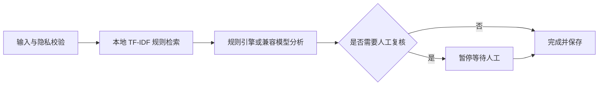

# Ad Review Agent｜广告体验审核智能体

Ad Experience Insight Assistant 是面向广告商业化产品经理、体验治理、内容审核和运营人员的个人作品。它把素材说明与用户反馈转换为统一标签、风险等级、可追溯证据和结构化策略建议，并支持批量处理、人工复核、Prompt 版本、合成评测与匿名实验分桶。

项目新增了一个**有边界的 LangGraph Agent 工作流**：输入校验 → 本地规则检索 → 风险分析 → 条件路由。低风险自动完成，高风险会暂停并等待人工接受或修改后再继续。Agent 只负责分析和建议，不执行下线、处罚或投放修改。

“综合归因”支持上传包含 `ad_id`、`feedback`、`image_filename` 等字段的 CSV，并同时上传对应素材图片。系统会按广告 ID 聚合多条反馈，输出主因分布、风险等级、证据、建议、素材匹配情况与人工复核状态。Demo 模式只检查图片格式、大小和分辨率，不宣称已完成 OCR 或图片语义识别。

> 事实边界：本项目仅使用公开规则、完全合成数据和用户自行输入的数据。它不接入 vivo 内部系统，不使用 vivo 内部数据，不代表已在 vivo 上线，也不声称产生真实 CTR、收入或体验提升。所有内置记录和规范均标记为 synthetic/demo。

## 快速启动

要求 Node.js 22.13+、Python 3.11+。

```bash
python -m venv .venv
.venv/Scripts/pip install -r backend/requirements.txt
.venv/Scripts/python backend/run.py

# 新终端
npm install
npm run dev
```

打开前端输出的本地地址（通常为 `http://localhost:3000`）；API 文档位于 `http://127.0.0.1:8000/docs`。

也可以使用 Docker：

```bash
copy .env.example .env
docker compose up --build
```

启动后进入“Agent 工作台”。提交普通反馈会直接完成；提交“强制跳转、无法关闭、疑似诈骗”等高风险反馈，会看到工作流暂停和人工复核按钮。Agent API 为 `POST /api/agent/runs`，流程说明为 `GET /api/agent/graph`。

## Agent 是怎样工作的



- LangGraph 管理节点、状态、条件分支和人工中断；这是一条可解释的审核工作流，不是可以任意调用外部系统的全自动 Agent。
- 默认使用内存检查点，适合本地演示；服务重启后，尚未完成的 Agent 任务不会保留。生产化需换成持久化 checkpointer。
- 本地 RAG 返回真实规则片段和 `citation_id`；模型输出无法引用本次检索之外的规则。
- 当前 Agent 工作台处理文本审核；已有图片上传与综合归因仍通过独立接口运行，视觉语义分析只有在配置兼容视觉模型后才会启用。

## Demo Mode 与 Provider

复制 `.env.example` 为 `.env`。默认 `DEMO_MODE=true`，无需 API Key：关键词、风险规则和固定模板会产生可重复结果；耗时与 Token 字段为确定性模拟值，`simulated=true`，费用为 0。它与真实 Provider 共用 Pydantic schema，但不代表真实模型效果，也不进行视觉理解。

Provider Adapter 从后端环境变量读取 `LLM_API_KEY`、`LLM_BASE_URL`、`LLM_MODEL` 和 `LLM_PROVIDER`，不硬编码厂商或模型。设置 `DEMO_MODE=false` 后，真实 Provider 会消费本地 TF-IDF RAG 的可追溯片段，并经过 JSON Schema 校验、引用过滤、否定感知规则兜底与风险升级。配置不完整时会明确报错，不会静默伪装成真实模型。密钥不会返回前端、写入导出或普通日志。

图片审核支持 PNG/JPEG/WebP（最大 5MB），图片只在请求内存中处理，不写入磁盘。真实视觉审核还需显式设置 `ENABLE_IMAGE_REVIEW=true`，并使用支持图片输入的兼容模型；Demo 模式只记录“未完成视觉理解”并强制人工复核。真实模型批量评测默认关闭，避免意外产生 80 次调用费用。

逐步配置见 [`docs/model-setup.md`](docs/model-setup.md)。

## 数据、安全与验证

- CSV 仅允许白名单字段、UTF-8、最大 2MB；模板见 `sample-data/batch-template.csv`。
- 检测 IMEI、手机号、姓名、身份证、邮箱、设备标识字段；正文敏感模式也会阻止处理。
- critical 必须人工复核；病毒、恶意网站、诈骗、隐私风险会建议暂停自动放量并核查。
- 人工修正作为新记录保存，不覆盖 AI 原始输出；分析记录可删除。

```bash
.venv/Scripts/python -m pytest backend/tests -q
npm run lint
npm test
npm run build
```

当前仓库验收基线为 27 个后端测试、2 个前端组件测试和 2 个渲染测试；请以你本机最新一次 CI 或测试输出为准，不把合成数据成绩表述为线上业务效果。

运行评测：启动前后端，在“评测中心”点击运行。结果由固定合成集实际生成到 `docs/evaluation-report.md`，仓库不预填虚假高分。

## 目录

```text
app/                         前端页面与组件
backend/app/                 FastAPI、模型、检索、规则与 Provider
backend/tests/               后端验收测试
data/policies/               7 份 synthetic demo 演示规范
data/synthetic_records.json  116 条合成记录（80 评测）
docs/                        产品、架构、评测、安全与面试材料
sample-data/                 CSV 模板
scripts/                     合成数据生成脚本
.github/                     CI、Issue 模板
```

截图建议放到 `docs/screenshots/`，命名 `overview.png`、`single-analysis.png`、`evaluation.png`。本项目不包含伪造的官方截图、Logo 或内部界面。“AI 建议，仅供辅助判断”。

## 参与项目

本地开发与提交规范见 [`CONTRIBUTING.md`](CONTRIBUTING.md)，安全问题见 [`SECURITY.md`](SECURITY.md)，社区约定见 [`CODE_OF_CONDUCT.md`](CODE_OF_CONDUCT.md)。项目采用 [`MIT License`](LICENSE)。

