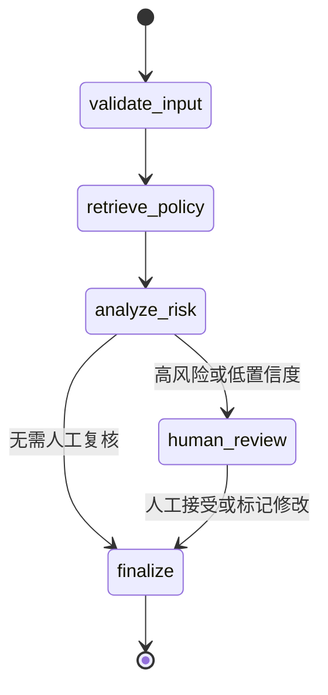
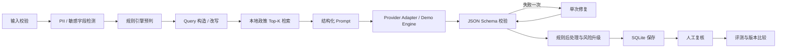
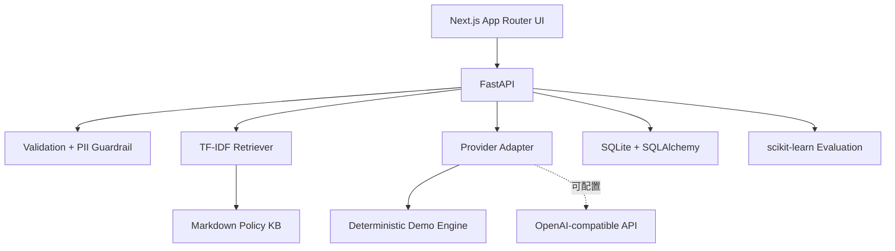
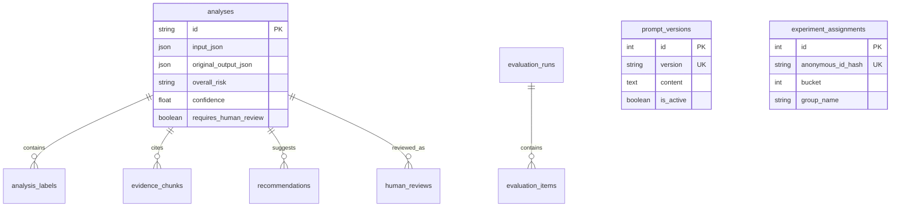

# 系统架构

## 有边界的 Agent 工作流

LangGraph 保存任务状态并负责条件路由。`human_review` 使用 interrupt 暂停执行，只有显式人工决定后才恢复。当前使用进程内检查点，定位是可运行的本地 Demo；生产部署应改用持久化检查点并增加鉴权、审计和并发控制。

## ER 图

## 关键决策

- 字符 TF-IDF 对中文短反馈离线、确定、无需分词；Embedding 是 P1。
- 无密钥 Demo 与 Provider 共用 schema；不绑定模型。
- no_issue 互斥，风险只升级，critical 强制复核。
- citation_id 只能映射本次真实 chunk；无证据返回空引用。
- AI 原始输出不可变，人工修正版独立保存。
- 错误分类：validation_error、retrieval_error、provider_timeout、provider_rate_limit、malformed_model_output、policy_guardrail_triggered、unknown_error。超时/限流有限重试，结构修复仅一次。
- Agent 权限边界：只读规则、生成分析、保存分析与人工决定；不连接广告投放或处罚执行系统。

